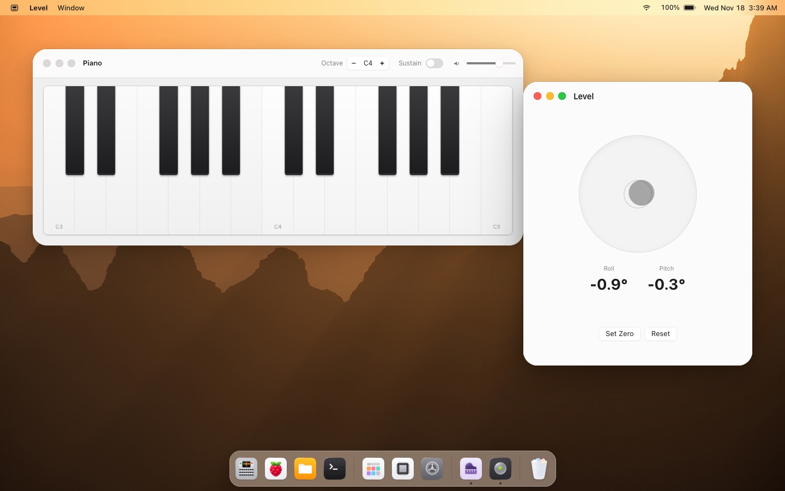
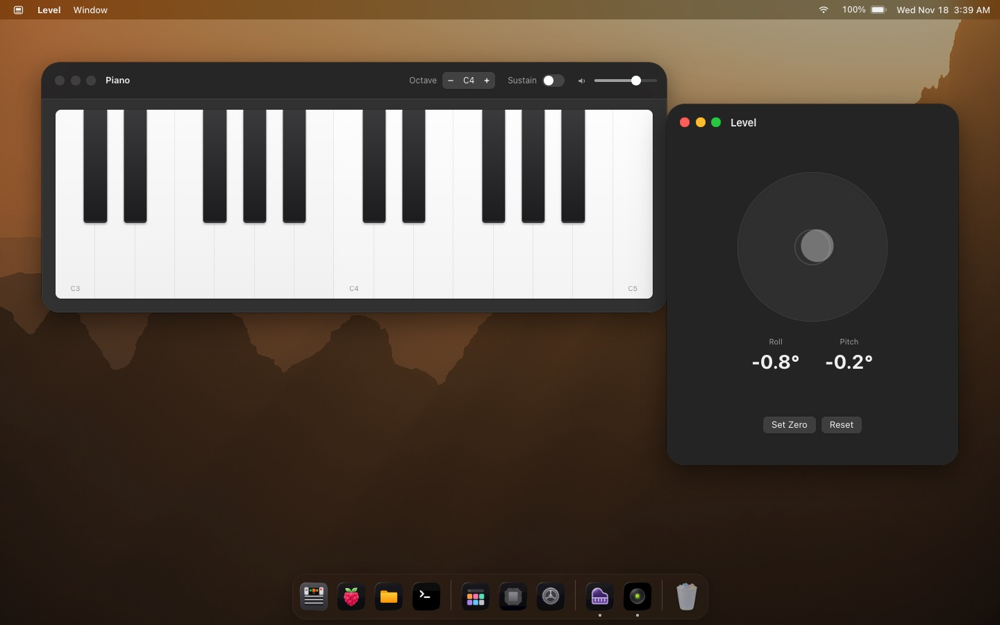
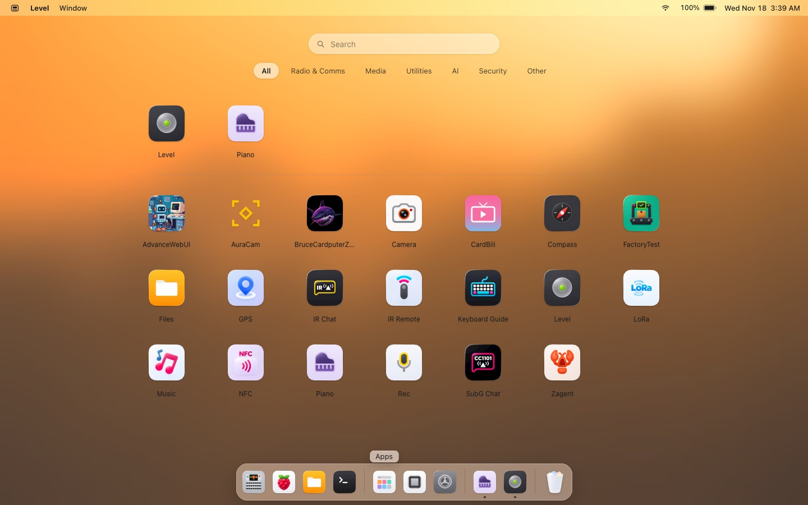
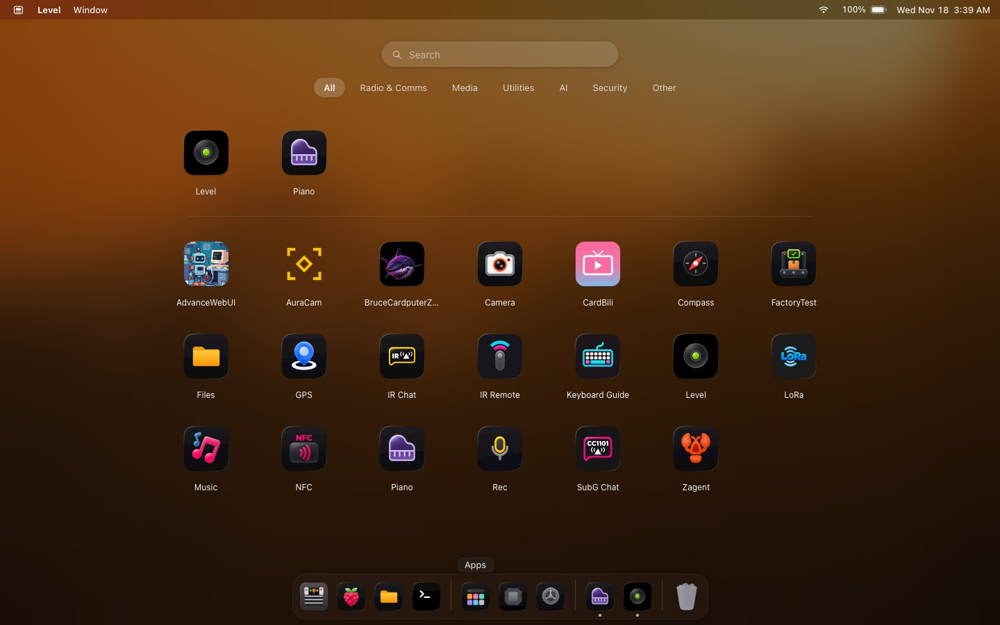

# ZeroDesk

ZeroDesk turns your M5Stack CardputerZero into a desktop you use from your computer's web browser. It looks and works like macOS: windows you can drag and resize, a Dock, an Apps screen, Finder for the files on the device, a Terminal, System Settings, and native apps such as Music, Piano and Voice Memos. You can also see and use the CardputerZero's own screen in a window, and run its apps on your computer with your mouse and keyboard. Light and dark appearance, English and Chinese.

| Light | Dark |
|---|---|
|  |  |
|  |  |

## What you need

- A CardputerZero with its standard system (the image with the APPLaunch launcher, Debian 13).
- The CardputerZero and your computer on the same network (Wi-Fi or Ethernet).
- A current browser on the computer: Chrome, Edge, Safari or Firefox.

## Install

1. Download the latest `zerodesk_<version>_arm64.deb` from this repository's **Releases** page.
2. Copy it to the CardputerZero (for example with `scp`, or a USB stick).
3. On the CardputerZero (Terminal app, or SSH), run:

   ```bash
   sudo apt install ./zerodesk_<version>_arm64.deb
   ```

ZeroDesk starts right away and every time the device starts. It uses about 6 MB of memory while idle.

## Open it from your computer

1. In the browser, go to **http://cardputerzero.local** (the device's name on your network). If that does not open, use the device's IP address instead, which the launcher's IP Panel app shows: `http://<ip-address>`.
2. Click **Connect to CardputerZero**. The device shows a request; press **OK** on the CardputerZero's keyboard within 60 seconds.
3. The desktop opens. Your browser stays connected until you log out (Settings → General).

Someone on the same network cannot connect without pressing OK on the device. If the device's keyboard is not available, choose **Use an access token** and enter the token stored on the device in `~/.config/zerodesk/token`.

## Built-in apps

| App | What it does |
|---|---|
| Cardputer | The device's own screen in a window. Click the picture, then type on your computer's keyboard |
| Linux Desktop | The device's graphical desktop, when it has one |
| Finder | Browse, upload and download files; drag files from your computer into a window; install `.deb` packages |
| Terminal | A shell on the device |
| Apps | Every app installed on the CardputerZero, sorted by category |
| Settings | Wi-Fi, network, battery, display brightness and sleep, sound, expansion-port power, date and time, appearance |
| Music | Plays the music in `~/Music` |
| Piano | A full piano with real grand-piano samples; play with the mouse or the keyboard (A–L row) |
| Voice Memos | Records with the device's microphone; play back, scrub and delete recordings |
| Zagent | Settings of the Zagent assistant (when Zagent is installed) |
| About This Device | Model, memory, storage and system version |

## Other apps

Apps installed on the CardputerZero (from its App Store or as `.deb` files) appear in **Apps**.

- Apps that ship a ZeroDesk window open as normal windows, like the built-in apps.
- Other apps run on the computer in a window that shows their screen; use your mouse and keyboard. Choose **Open on Zero** to run them on the device instead.

App developers: see [docs/APP-SPEC.md](docs/APP-SPEC.md) for how to give an app its own ZeroDesk window, and [examples/level](examples/level) for a small example.

## Update

Download the newer `.deb` and install it the same way. Your settings and connection are kept.

## Uninstall

```bash
sudo apt remove zerodesk
```

To also remove the access token and app data: `rm -rf ~/.config/zerodesk ~/.local/share/zerodesk`.

## FAQ

**The address does not open.** Make sure the computer and the CardputerZero are on the same network, then try the IP address instead of `cardputerzero.local`. Some networks block device names; the IP always works.

**I pressed OK but nothing happened.** The request lasts 60 seconds. Click **Connect again** and press OK while the request is shown on the device.

**Is it safe on a shared network?** Connecting needs a key press on the device or its access token. The connection is plain HTTP, so use ZeroDesk on networks you trust.

**Does it change how the device works on its own?** No. The launcher and its apps work as before. While an app runs on the device's screen, ZeroDesk shows that screen in the Cardputer window.

**It feels slow.** Window content comes from the device over Wi-Fi; a strong signal helps. Closing the Cardputer and Linux Desktop windows saves bandwidth when you do not need them.

---

Building, deploying and the internals are described in [docs/DEVELOPMENT.md](docs/DEVELOPMENT.md).
